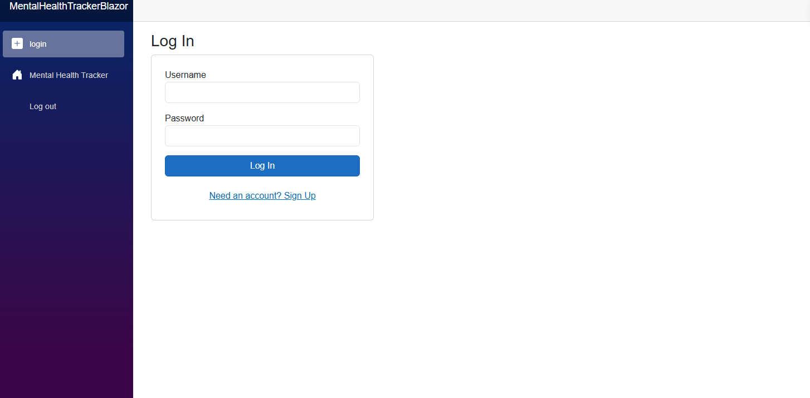
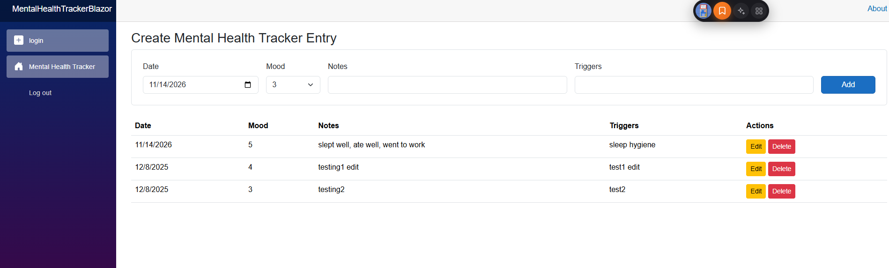

# Mental Health Tracker

A small Blazor web app for logging daily mood, notes, and triggers. Each account has its own
entries — every read, update, and delete is filtered by the signed-in user's ID, so no one can see
or touch anyone else's data.

Built as a portfolio project to work through ASP.NET Core, Blazor, and SQL Server end to end, then
hardened after a security review (see [Security notes](#security-notes)).

> **Not a medical product.** This is a learning project, not a clinical tool, and it is not a
> substitute for professional mental health care.

## Screens






Sign-up and login share this one page behind *Need an account? Sign Up*. A successful login issues
the auth cookie and sends you to the tracker; a failed one returns here with an error.

## Features

- **Accounts** — sign up and log in from a single page. Passwords are hashed; sessions use an
  auth cookie.
- **Daily entries** — record a date, a mood from 1–5, free-text notes, and free-text triggers.
- **Inline editing** — click Edit to turn a row into inputs, then Save or Cancel. No page reloads.
- **Delete** — remove an entry, scoped to your own account.
- **Newest first** — entries are loaded and sorted by date, most recent at the top.
- **Per-user isolation** — the user ID comes from the authentication claim, never from the form.

## Tech stack

| Layer | Choice |
|---|---|
| Framework | .NET 10, ASP.NET Core |
| UI | Blazor Web App, Interactive Server render mode, Bootstrap 5 |
| Auth | Cookie authentication (`Microsoft.AspNetCore.Authentication.Cookies`), claims-based |
| Data access | ADO.NET (`Microsoft.Data.SqlClient`) with parameterised SQL |
| Database | SQL Server |
| Password hashing | `PasswordHasher<object>` (PBKDF2, per-password salt) |

Data access is deliberately plain: hand-written SQL in `EntryManager`, no ORM in the request path.

## Project layout

```
MentalHealthTrackerBlazor.slnx
CreateMHTTables.sql                  -- creates both tables
MentalHealthTrackerBlazor/
  Program.cs                         -- service setup, auth config, /login-handler, /logout-handler
  Data/
    MentalHealthEntry.cs             -- entry model (UserId, EntryId, Date, Mood, Notes, Triggers)
    EntryManager.cs                  -- parameterised CRUD, user registration, password checks
  Components/
    App.razor                        -- router with AuthorizeRouteView
    RedirectToLogin.razor            -- sends unauthenticated visitors to the login page
    Pages/
      Login.razor                    -- "/" login + sign-up
      MHT.razor                      -- "/mht" the tracker itself
      Logout.razor                   -- "/logout" confirmation page
    Layout/NavMenu.razor             -- navigation and log-out link
  Security/LocalUrl.cs               -- return-URL sanitiser used to block open redirects
```

## Routes

| Route | Purpose | Access |
|---|---|---|
| `/` | Log in / sign up | Public |
| `/mht` | Add, edit, and delete entries | Requires a session |
| `/logout` | "Are you sure?" page with a POST form | Public |
| `POST /login-handler` | Validates credentials, issues the cookie | Public |
| `POST /logout-handler` | Clears the cookie (antiforgery token required) | Public |

`/mht` is protected by an `[Authorize]` attribute, and the router uses `AuthorizeRouteView`, so
visiting it while signed out redirects to `/?returnUrl=%2Fmht` instead of rendering the page.

## Getting started

### Prerequisites

- [.NET 10 SDK](https://dotnet.microsoft.com/download)
- SQL Server (Express, LocalDB, or Developer edition) and SQL Server Management Studio, or Visual
  Studio's SQL Server Object Explorer

### 1. Create the database and tables

Create an empty database named `MentalHealthTracker`, then run `CreateMHTTables.sql` against it
(in SSMS or Visual Studio: right-click the database → **New Query** → paste → **Execute**).

It creates two tables:

| Table | Columns |
|---|---|
| `MentalHealthEntries` | `EntryID` (identity PK), `userID`, `Date`, `Mood`, `Notes`, `Triggers` |
| `Users` | `UserId` (identity PK), `Username` (nvarchar 50, not null), `PasswordHash` (nvarchar max, not null) |

### 2. Point the app at your instance

Edit the connection string in `MentalHealthTrackerBlazor/appsettings.json`. It uses Windows
authentication, so there is no password in the file:

```json
"ConnectionStrings": {
  "DefaultConnection": "Server=.\\SQLEXPRESS;Database=MentalHealthTracker;Trusted_Connection=true;TrustServerCertificate=True;"
}
```

<<<<<<< HEAD
Replace `.\\SQLEXPRESS` with your own server name — for LocalDB use `(localdb)\\MSSQLLocalDB`.
=======
Replace `.\SQLEXPRESS` with your own server name — for LocalDB use `(localdb)\\MSSQLLocalDB`.
>>>>>>> f7d456c748283f976ab867972bdbb78121f6b7c1

### 3. Run it

```bash
dotnet run --project MentalHealthTrackerBlazor
```

Then open <http://localhost:5271> (or <https://localhost:7110> for the HTTPS profile).

### 4. Use it

Click **Need an account? Sign Up**, create a username and password, log in, and you land on the
tracker. Add an entry, edit a row, delete it, then log out.

## Security notes

These were added in response to a security review and are the part of the project I'd point at
first:

- **Passwords are hashed, never stored** — `PasswordHasher<object>` derives a PBKDF2 hash with a
  per-password salt. Verification uses a fixed-time comparison. Existing plaintext rows are upgraded
  in place on the next successful login, so old accounts repair themselves.
- **Open redirects are blocked** — the `returnUrl` posted by the login form is sanitised by
  `LocalUrl`, which rejects absolute and protocol-relative URLs, and the result is issued through
  `Results.LocalRedirect`. A crafted `?returnUrl=https://example.com` cannot bounce a freshly
  authenticated user off-site.
- **The session cookie is hardened** — `MHT.Auth` is `HttpOnly`, `SameSite=Lax`, `Secure` whenever
  the app is not running in Development, and expires after 8 hours of inactivity rather than the
  14-day default. Health data should not sit in a long-lived session.
- **Transport is protected in production** — HTTPS redirection always, HSTS with a one-year max age
  outside Development, and a real `/Error` handler instead of a stack trace.
- **Logout is a POST with an antiforgery token** — a GET link could be triggered from another site.
  The static `/logout` page posts to `/logout-handler`, which validates the token first.
- **Queries are parameterised and user-scoped** — every statement uses `@parameters`, and updates
  and deletes carry `WHERE EntryId = @EntryId AND UserId = @UserId`, with the user ID taken from the
  claim rather than from the request body.

## Known limitations

Listed honestly, because they are the interesting parts of the roadmap:

- **No automated tests.** Everything so far was verified by hand: build, then exercise the sign-up,
  login, add, edit, delete, and log-out paths.
- **No login rate limiting or lockout**, so passwords can be guessed without throttling.
- **No password strength rules** beyond non-empty and under 256 characters.
- **Username uniqueness is checked in application code**, not by a database constraint, so two
  simultaneous sign-ups could in principle collide. A unique index on `Username` would close that.
<<<<<<< HEAD
- **No password reset** — a forgotten password means a dead account, with no admin route back in.
=======
>>>>>>> f7d456c748283f976ab867972bdbb78121f6b7c1
- **Entries are hard-deleted** — no soft delete, no history.
- **Schema is applied by script**, not EF migrations. The `dotnet-ef` tool manifest and the EF Core
  package references are leftovers from an earlier approach and are unused at runtime.
- **Leftover template pages** (`/counter`, `/weather`) are still in the repository.
- **Mood is a fixed 1–5 scale**, with no trend view or chart yet.

## Roadmap

- [ ] xUnit tests around `LocalUrl`, password hashing, and `EntryManager`
- [ ] A unique index on `Users.Username`
- [ ] Login throttling and lockout
<<<<<<< HEAD
- [ ] Password reset flow
=======
>>>>>>> f7d456c748283f976ab867972bdbb78121f6b7c1
- [ ] Mood-over-time chart on the tracker page
- [ ] Export entries to CSV
- [ ] Account deletion and data export, for privacy
- [ ] Remove the unused EF Core references and template pages
- [ ] Containerise and deploy

## License

No license file yet — treat the code as source-available for review rather than reusable.

---

Feedback and suggestions are welcome via GitHub issues.
